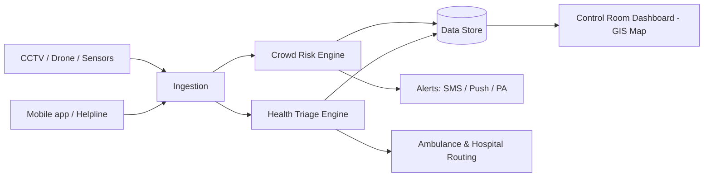

# KumbhSafe Architecture

## Components
| Component | Status | Notes |
|---|---|---|
| Crowd Risk Engine (`crowd.py`) | Prototype done | Density + inflow growth -> risk level |
| Health Triage Engine (`triage.py`) | Prototype done | Rule-based; ML model pluggable |
| Ingestion (`engine.py`) | Prototype done | Simulated feed; swap `tick()` for CV/sensor counts |
| Dashboard (`web/`) | Prototype done | Live SVG map, alerts, triage and SOS forms |
| API (`server.py`) | Prototype done | stdlib HTTP, JSON |
| Geo routing (`geo.py`) | Prototype done | Nearest facility + ETA |
| SMS/push alerts, real map tiles | Planned | Gateway + Leaflet/OpenStreetMap |

## Design choices
- Explainable rules first, so officials can trust and audit decisions.
- Same function interfaces allow swapping in ML models later.
- Works offline-capable at edge for low-network Kumbh sites.
